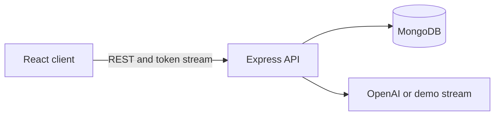

# DevGPT

DevGPT is a ChatGPT-style chat app built with the MERN stack: MongoDB, Express, React, and Node. You can register, keep conversations, and watch replies stream in. Answers can include lists, tables, and images, and a row of choices can continue the thread.

The one bonus feature is **dark mode**. It is available from the header and from Settings, and the choice is saved on the user.

## Features

- Email and password accounts, with a saved display name and theme
- Conversation list with create, rename, and delete
- Streaming assistant replies
- Rich answers: GitHub-flavored markdown for lists, tables, code blocks, and images
- Choice chips under a reply, plus starter prompts on an empty chat
- Light and dark themes through Material UI

Without an API key the server streams a local demo reply, so the interface still works. Add `GROQ_API_KEY` when you want live model answers.

## Stack

| Layer | Choice                                                            |
| ----- | ----------------------------------------------------------------- |
| UI    | React 18, Vite, Material UI, React Router                         |
| State | React Context for auth and theme, a `useChat` hook for the thread |
| API   | Express REST API, JWT auth                                        |
| Data  | MongoDB and Mongoose                                              |
| Model | Groq, or the built-in demo stream when no key is set              |

## Prerequisites

- Node.js 18 or newer (Node 20+ is a good default)
- MongoDB running locally, or a MongoDB Atlas connection string

Optional ways to get MongoDB:

```bash
# macOS, if you use Homebrew
brew tap mongodb/brew
brew install mongodb-community
brew services start mongodb-community
```

```bash
# or start only the database with Docker
docker run -d --name devgpt-mongo -p 27017:27017 mongo:7
```

Atlas works too. Put the connection string in `MONGODB_URI`.

## Setup

From the project root:

```bash
npm install
npm run setup
cp server/.env.example server/.env
```

Open `server/.env` and set `JWT_SECRET` to a long random string. The example value is fine for a local demo and should be changed before any shared deployment.

Start MongoDB, then start the app:

```bash
npm run dev
```

Open [http://localhost:5173](http://localhost:5173).

- The site runs on port **5173**.
- The API runs on port **5050**. Port 5000 is often taken by AirPlay on macOS, so this project avoids it.
- In local dev, Vite proxies `/api` to the API, so you can leave `VITE_API_URL` empty.

`npm run dev` runs both processes and restarts the API when server files change. You can also use two terminals:

```bash
npm run dev --prefix server
npm run dev --prefix client
```

### Try it

1. Create an account.
2. Send a message and watch the reply stream.
3. Use **Make a table** or **Show an image** under the reply.
4. Toggle dark mode in the header. Refresh the page and confirm it stuck.
5. Rename or delete the chat from the `…` menu, then refresh and confirm the sidebar matches.

### Live model answers

In `server/.env`:

```bash
GROQ_API_KEY=gsk_...
GROQ_MODEL=openai/gpt-oss-120b
```

Restart the API. The **Demo** chip disappears when a Groq key is in use. Requests go to `https://api.groq.com/openai/v1`.

`OPENAI_API_KEY` is used only when `GROQ_API_KEY` is empty.

### Production build

```bash
# client/.env.production or the shell environment
# VITE_API_URL=https://your-api.example.com

npm run build
```

The static files are written to `client/dist`. Serve them behind any static host and run the API with:

```bash
npm start
```

Set `CLIENT_URL` to the site origin so the API accepts browser requests.

## Environment

Server (`server/.env`):

| Variable          | Required | Purpose                                                              |
| ----------------- | -------- | -------------------------------------------------------------------- |
| `PORT`            | No       | API port. Default `5050`.                                            |
| `MONGODB_URI`     | No       | Mongo connection string. Default `mongodb://127.0.0.1:27017/devgpt`. |
| `JWT_SECRET`      | Yes      | Signs login tokens. The API will not start without it.               |
| `CLIENT_URL`      | No       | Allowed browser origin. Default `http://localhost:5173`.             |
| `GROQ_API_KEY`    | No       | Groq key. Blank, with no OpenAI key, uses demo replies.              |
| `GROQ_MODEL`      | No       | Default `openai/gpt-oss-120b`.                                       |
| `OPENAI_API_KEY`  | No       | Used only when `GROQ_API_KEY` is empty.                              |
| `OPENAI_MODEL`    | No       | Default `gpt-4o-mini`.                                               |
| `OPENAI_BASE_URL` | No       | Default `https://api.openai.com/v1`.                                 |

Client:

| Variable       | Required | Purpose                                                                   |
| -------------- | -------- | ------------------------------------------------------------------------- |
| `VITE_API_URL` | No       | API origin for a production build. Leave empty when using the Vite proxy. |

## Scripts

| Command         | What it does                               |
| --------------- | ------------------------------------------ |
| `npm install`   | Installs the root helper (`concurrently`). |
| `npm run setup` | Installs server and client dependencies.   |
| `npm run dev`   | Starts the API and the Vite app together.  |
| `npm start`     | Starts the API only.                       |
| `npm run build` | Builds the client.                         |
| `npm test`      | Runs the server and client unit tests.     |

`npm test` does not need MongoDB or a Groq key. The server tests call the route handlers with the database mocked, and a reply stream uses the local demo.

## API

Authenticated routes expect `Authorization: Bearer <token>`.

| Method   | Path                              | Purpose                                                                |
| -------- | --------------------------------- | ---------------------------------------------------------------------- |
| `GET`    | `/api/health`                     | `{ ok, ai }` where `ai` is `demo` or `openai`                          |
| `POST`   | `/api/auth/register`              | Create an account. Body: `name`, `email`, `password`, optional `theme` |
| `POST`   | `/api/auth/login`                 | Returns `{ token, user }`                                              |
| `GET`    | `/api/auth/me`                    | Current user                                                           |
| `PATCH`  | `/api/auth/me`                    | Update `name` and/or `theme`                                           |
| `GET`    | `/api/conversations`              | Sidebar list, newest first                                             |
| `POST`   | `/api/conversations`              | Create an empty conversation                                           |
| `GET`    | `/api/conversations/:id`          | One conversation, including messages                                   |
| `PATCH`  | `/api/conversations/:id`          | Rename. Body: `title`                                                  |
| `DELETE` | `/api/conversations/:id`          | Delete a conversation                                                  |
| `POST`   | `/api/conversations/:id/messages` | Save the user message and stream the reply                             |

The message route is the one streaming exception. It is still `POST` a message, and the response is `text/event-stream` rather than a single JSON body:

```text
data: {"conversationId":"...","title":"Hello","updatedAt":"..."}

data: {"token":"Here "}

data: {"token":"is "}

data: {"done":true,"demo":true,"title":"Hello"}
```

Errors on that stream arrive as `data: {"error":"..."}`.

Example:

```bash
curl -s -X POST http://localhost:5050/api/auth/register \
  -H 'Content-Type: application/json' \
  -d '{"name":"Ada","email":"ada@example.com","password":"secret12"}'
```

## Architecture



```text
client/src
  App.jsx                     theme and routes
  api.js                      fetch helpers and the stream reader
  context/AuthContext.jsx     session
  context/ThemeModeContext.jsx  light or dark
  hooks/useChat.js            conversation list and the open thread
  pages                      login, register, chat
  components                 sidebar, composer, markdown, settings

server/src
  index.js                    Express app
  routes/auth.js              accounts and settings
  routes/conversations.js     chats and the stream
  services/ai.js              OpenAI stream, or the demo reply
  models                      User and Conversation
```

A user owns many conversations. Each conversation stores its messages in order. The client keeps the open thread in memory and reloads it from the API when you pick another chat.

## UI


## Design decisions

- **Context instead of Redux.** Auth and theme are small, and the open chat lives in one hook. A store would add structure this app does not need yet.
- **Messages live on the conversation.** Loading a thread is one read. A separate messages collection is the next step if threads become very large.
- **JWT in `localStorage`.** The SPA can send it on every request, including the stream. An httpOnly cookie would be the stricter next step.
- **Demo mode.** Reviewing the UI should not depend on a paid API key. The demo reply is markdown on purpose, so lists, a table, and an optional image show up without a key.
- **Dark mode as the only bonus.** Material UI already owns the palette, so the toggle, both screens, and the saved preference stay a small feature. Caching, Docker, migrations, charts, syntax highlighting, search, copy, and export are not included.
- **Markdown for rich content.** Lists, tables, images, and code blocks are rendered from GitHub-flavored markdown. That covers the rich-content requirement. Code is shown in a plain block, without syntax highlighting.

## Assumptions

- One person uses one account. There is no sharing.
- A conversation belongs to one user, and every query checks that owner.
- The model only needs the latest 12 messages of context.
- Node can reach MongoDB and, when a key is set, the model endpoint.
- Users are fine signing in again after 7 days.

## Limitations

- Stopping a reply keeps the text already on screen. The server also stores whatever it generated up to the disconnect, so a refresh can show a bit more than the stopped view.
- A half-finished table can flicker while tokens are still arriving.
- There is no edit, regenerate, file upload, or search.
- Tokens are stored in `localStorage`. Raw HTML from the model is not rendered, and links are limited to `http`, `https`, and `mailto`.
- Login uses the same error for a bad email and a bad password. Register does say when an email is already taken.
- Demo replies are a template. They are there so the product works before a key is added.
- Auth attempts are rate-limited in process memory. That resets when the API restarts and does not span multiple servers.

## Troubleshooting

**`Could not connect to MongoDB`**  
The API exits until Mongo is reachable. Start the local database, or set `MONGODB_URI` to Atlas.

**`Cannot reach the server` in the UI**  
The API is not running, or it crashed on startup. Check the `api` logs from `npm run dev`.

**The Demo chip is still there**  
`GROQ_API_KEY` is empty or the API was not restarted after the env change.

**Port already in use**  
Change `PORT` in `server/.env`, or stop the other process on 5173 or 5050.
